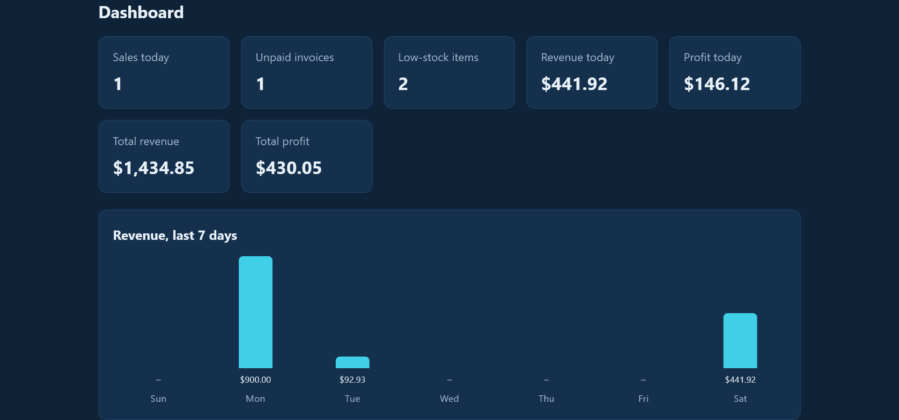
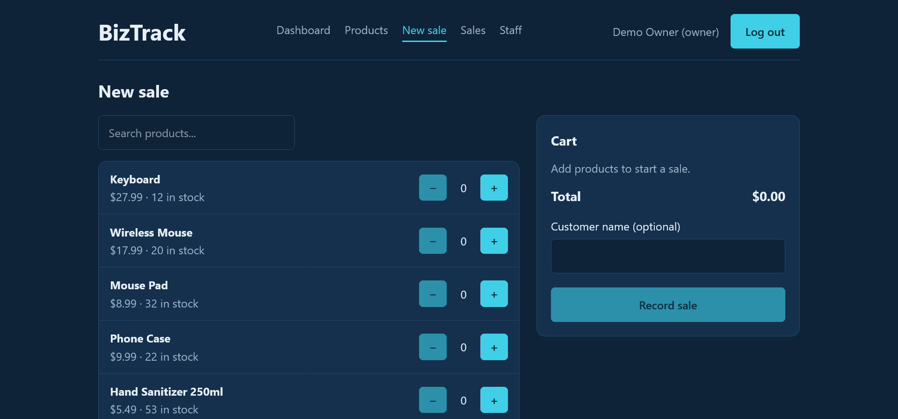
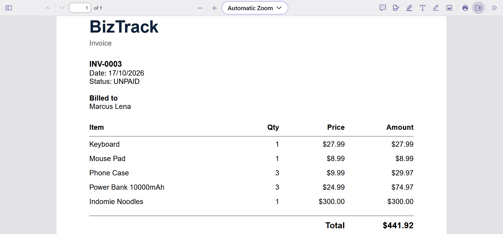
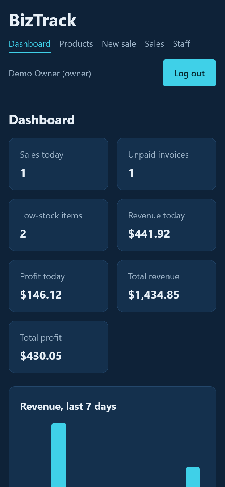

# BizTrack

Invoicing and inventory app for small shops. Record sales, track stock, create invoices as PDFs, and see how the business is doing, with separate access for owners and staff.

**Live demo:** https://biztrack-nu-wine.vercel.app

> The API runs on a free server that sleeps when idle, so the first login can take up to a minute.

## Try it

On the login page, press **Owner** or **Staff** to fill in the demo login.

| Role | Email | Password |
|---|---|---|
| Owner | demo.owner@biztrack.com | DemoOwner123 |
| Staff | demo.staff@biztrack.com | DemoStaff123 |

The demo is shared and public, so please don't enter real information.

## Screenshots








## Features

- **Sales:** record a sale and stock goes down automatically. Selling more than you have in stock is refused.
- **Invoices:** create an invoice from any sale, download it as a PDF, and mark it paid.
- **Dashboard:** today's sales, a 7-day chart, low-stock alerts, and unpaid invoices.
- **Owner and staff roles:** only the owner can edit products and prices, manage staff, and see cost and profit. Staff only see their own sales.
- **Price history stays correct:** each sale remembers the price and cost at the time of sale, so changing a price never rewrites past sales.
- **Works on phones:** the layout adapts to small screens.

## Tech stack

- **Front end:** React, TypeScript, Vite, React Router
- **Back end:** Node.js, Express, TypeScript
- **Database:** MongoDB Atlas with Mongoose
- **Auth:** JWT tokens, bcrypt password hashing
- **PDFs:** PDFKit
- **Tests:** Jest and Supertest (22 API tests)
- **Hosting:** Vercel (front end), Render (API)

## Run it locally

You need Node.js and a MongoDB database (MongoDB Atlas has a free tier).

```bash
git clone https://github.com/OscarmbahDevHub/biztrack.git
cd biztrack

# API
cd server
npm install
# create server/.env with: PORT, MONGODB_URI, JWT_SECRET
npm run dev

# Front end (in a second terminal)
cd client
npm install
npm run dev
```

Run the API tests with `npm test` inside the `server` folder. They use a separate `biztrack_test` database.

## What I learned

Designing roles and permissions, keeping stock correct when two sales happen at once, writing API tests, and deploying a full-stack app across Vercel and Render, including fixing the real problems that come up when you go live.

## Author

Oscar Mbah, a full-stack developer from Enugu, Nigeria.